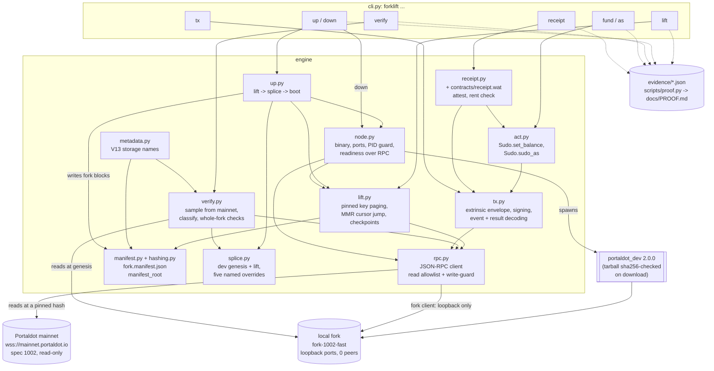

# Architecture

Forklift is a Python command-line tool. It reads Portaldot **mainnet (runtime spec 1002)** through the public node,
splices that state into the `portaldot_dev` 2.0.0 chain spec, boots a local fork, and then checks and acts on
the fork. This page describes what the code in this repository does today; parts that are not built are labelled
**planned**. It was written from the modules and their imports (`forklift/*.py`), not from a design document.

A fork is a **local fork of Portaldot mainnet state (spec 1002) that runs the dev runtime wasm**, labelled `fork-1002-fast`. It is not the
Portaldot V3 testnet and nothing here has run against V3 (see the README, *V3 status*).

## Modules and commands

Solid arrows are the main calls and data flow in the code (not every import). Dotted arrows are the optional `--evidence DIR` output of each command
(small JSON summaries; `scripts/proof.py` turns them into `docs/PROOF.md`, `scripts/refetch.py` re-reads every recorded
transaction by extrinsic id from a separate process).

## What each module is responsible for

| Module | Responsibility |
|---|---|
| `rpc.py` | Raw JSON-RPC over `websockets`: request ids, retry with backoff, timeouts. A *read-only* client sends only an allowlist of read methods (`author_*` and everything else is refused before the socket). A *fork client* exists only for loopback endpoints that are not a known mainnet host, and checks the genesis hash is not mainnet's before its first write and on every new connection. |
| `lift.py` | Resolves the pin (`N`, `0xhash` or `head` = latest finalized), pages `state_getKeysPaged` at that hash from `0x`, jumps the cursor past the MerkleMountainRange prefix, fetches values with `state_queryStorageAt` at the same hash, checkpoints the cursor after every page. A failed lift stays a checkpoint (exit code 4); `manifest.json` is written only after every value was read. |
| `metadata.py`, `hashing.py` | Storage names from runtime metadata V13 (`twox128(pallet) ‖ twox128(item)` to `Pallet.Item`); `twox128`, blake2 hashes and `manifest_root` (blake2-256 over the key-sorted, length-framed key/value pairs). |
| `manifest.py` | `fork.manifest.json`: source (endpoint, block number and hash, spec version, mainnet `:code` hash), load (keys lifted, bytes, MMR keys skipped, counts per pallet and item), `manifest_root`; the fork, node and overrides blocks are filled by `up`. |
| `splice.py` | Takes the node's own `build-spec --dev --raw` genesis and replaces it with the lift. **Dev** values stay for Babe, Grandpa, Session, AuthorityDiscovery, ImOnline, Authorship, `:grandpa_authorities`, `:extrinsic_index` and every `System` item except `System.Account`; the MMR prefix is **reset**; five **overrides** are listed with their reason: `Sudo.Key`, `Staking.ForceEra`, the dev key's `System.Account`, `Balances.TotalIssuance`, `:code`. Every lifted key lands in exactly one class (identical, dev-kept, override, or reset for the MMR range; reset is 0 for a lift that skips it). |
| `node.py` | Finds or downloads the `portaldot_dev` binary (the tarball is sha256-checked on download; the binary's sha256 is recorded in every manifest), builds a loopback-only command line (`--reserved-only`, no mDNS, no telemetry, no boot nodes), waits for readiness **over RPC** (a new block within two slots, finalization, 0 peers), writes a PID record and stops only a process whose recorded command line (or, failing an exact match, its binary, WebSocket port and chain spec) matches it. |
| `up.py` | `forklift up`: lift (or reuse a cached complete lift of the same block hash) → splice → boot → write the manifest and print the data plate. |
| `verify.py` | Draws keys **from mainnet** at the pin inside storage maps (weighted by per-item counts), reads each on mainnet at the pin and on the fork at genesis, classifies it (identical, dev-kept, override, reset, mismatch), and runs whole-fork checks: genesis key-set hash, issuance, the five overrides on both sides, both runtime code hashes. Exit 0 only when nothing is unexplained. |
| `tx.py`, `act.py` | Build the version-4 extrinsic envelope explicitly (the seven signed extensions of spec 1002; any other list is refused), sign with the fork's dev key, submit through the fork client, find the extrinsic by block scan, await finalization, decode events and the dispatch result. `fund` = `Sudo.sudo(Balances.set_balance)`; `as` = `Sudo.sudo_as(<call>)` with the call composed from metadata and the account's storage read before and after. |
| `receipt.py`, `contracts/receipt.wat` | A hand-written WAT contract for the rent-era Contracts pallet (`seal0` imports only). `attest` emits `mainnet_block_hash ‖ manifest_root ‖ keys_lifted` (72 bytes) as `Contracts.ContractEmitted`; `forklift receipt` instantiates it on a fork's first run, tops its balance up so it pays no rent, attests, decodes the event and compares it with the manifest. |

## Invariants the code enforces

- **Mainnet is read-only.** Only allowlisted read methods can reach a mainnet client, and a write client refuses any
  endpoint that is not loopback or whose genesis is mainnet's.
- **A complete lift is the whole key set.** Paging ends only on an empty page, the cursor checkpoint is verified, and
  `scripts/completeness.py` compares the lifted key *set* with an independent full listing at the same hash (minus the
  MMR range).
- **Every lifted key is accounted for:** identical + dev-kept + overridden (+ reset, 0 here) = lifted (`splice.py`, checked
  again by `verify`).
- **A fork never peers.** Empty boot nodes, `--reserved-only`, own chain id and protocol id; `up` stops the node if it has
  peers after boot.
- **Authoring is checked, not assumed.** `up` fails with exit 3 unless the node authors a block within two slots of
  becoming reachable and finalizes it.
- **Process safety.** One PID record per fork; `down` signals only that PID, and only if it is still that command.

## Exit codes and evidence

Exit codes `0/1/2/3/4/5/6/64` are documented per command in [`docs/EXIT-CODES.md`](docs/EXIT-CODES.md). Every measured
number in the README comes from [`docs/PROOF.md`](docs/PROOF.md), which `scripts/proof.py` regenerates from
[`evidence/`](evidence).

## Dependencies (`pyproject.toml`)

`click` (CLI), `websockets` (raw JSON-RPC), `xxhash` (`twox128`), `substrate-interface` (sr25519 keys and the SCALE type
registry; every byte still goes through `rpc.py`), `hatchling` (build), `pytest` (tests). blake2 comes from the
standard library. The `portaldot_dev` binary is downloaded at run time and is not a Python dependency.

## Planned (not built)

- `--runtime exact` (the mainnet runtime wasm on the fork) and a runtime-difference report.
- `forklift replay <block>:<index>` (re-run a mainnet extrinsic on a fork of its parent block).
- A hosted fork and a browser verify page.
- A PyPI package and a CI action.
- A V3 target. Per the organisers' Discord messages (not archived here) no V3 node binary or chain spec is public, so it
  cannot be built or measured yet.
