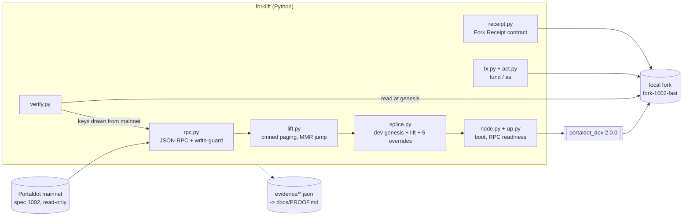

<div align="center">

# Forklift

**Portaldot mainnet state on a local `portaldot_dev` node: lifted at a pinned block, checked against mainnet key by key, and acted on as real accounts.**


Portaldot Hacker House 2026 · Track: Node Operations & Tooling

</div>

## Project Name

**Forklift** (`portaldot-forklift`, version 0.1.0): a command-line tool that gives a Portaldot developer a local chain
that starts from **mainnet's real state** instead of an empty dev chain.

> **Status: check-in slice.** Everything described as shipped below is in this repository and was measured on
> 2026-10-14 (measured numbers come from [`docs/PROOF.md`](docs/PROOF.md), generated from [`evidence/`](evidence); test counts from `pytest -q`; the contract size from `wc -c forklift/contracts/receipt.wasm`). Everything
> else is marked **planned**. The fork is a **local fork of Portaldot mainnet state (spec 1002)** that runs the
> `portaldot_dev` dev runtime, labelled `fork-1002-fast`. **It is not the Portaldot V3 testnet** (see *V3 status*).

## Project Overview

### Problem Statement

A local `portaldot_dev --dev` chain is a development chain: one validator named Alice, none of mainnet's accounts,
stakes or nominators. A builder who wants to test one staking call, or one contract, against the state their users are
actually on has no simple way to get that state onto a local node, and no way to check that what they got is faithful.

### Solution

Forklift is four steps.

1. **Lift.** `forklift lift` reads every top-level storage key of Portaldot mainnet at one pinned block hash (the
   Merkle Mountain Range storage is skipped, not paged through) and records what it read in a manifest with a
   `manifest_root` hash over every key/value pair.
2. **Splice and boot.** `forklift up` writes the lift into the `portaldot_dev` 2.0.0 chain spec, keeps the dev
   consensus keys so the node can author, applies five named overrides, boots the node on loopback-only ports with zero
   peers, and waits (over RPC) until it authors and finalizes.
3. **Verify.** `forklift verify` draws keys **from mainnet** (inside storage maps, weighted by how many keys each map
   holds), reads each on mainnet at the pin and on the fork at genesis, and exits `0` only when every key is identical
   or explained (dev-kept, override, reset) and the whole-fork checks pass (key set, issuance, overrides, runtime code hashes). It is a sample, not a proof of every key.
4. **Act.** `forklift fund` sets a balance, `forklift as <account> <Pallet.call> <args>` dispatches a call with a real
   mainnet account's origin (through `Sudo.sudo_as`), and `forklift receipt` deploys a small contract that emits the
   lift's block hash, `manifest_root` and key count as a `ContractEmitted` event on the fork, so a fork's origin is recorded on the fork itself.

**Shipped, in this repository today:**

- The lift engine: pinned paging, MMR cursor jump, per-page checkpoints, exit code `4` with the last cursor when the node
  fails for good (a partial lift is never written as complete), completeness checked against a second, unskipped full
  listing of the same block through the same RPC (`scripts/completeness.py`).
- The splice, node runner (tarball sha256-checked on download, binary sha256 recorded in the manifest, PID guard, no peers), `up` / `down`.
- `verify` with exit codes `0` / `2` and a reproducible seed.
- `fund`, `as`, `tx` (re-read any extrinsic by id), and the **Fork Receipt** contract with a rent check.
- An endpoint write-guard: nothing is ever submitted to mainnet, and a fork client refuses any non-loopback
  endpoint or a chain whose genesis is mainnet's.
- `--json` output and documented exit codes ([`docs/EXIT-CODES.md`](docs/EXIT-CODES.md)); 222 offline tests plus 4 live
  tests.

**Planned (not built, not claimed):** an `exact` runtime profile (mainnet's wasm on the fork), `replay` of a mainnet
extrinsic on a fork of its parent block, a hosted fork, a PyPI package and a CI action.

### Blockchain Relevance

Forklift is node-operations and developer tooling for Portaldot. It reads real chain state through the public node
(`wss://mainnet.portaldot.io`), runs it on the `portaldot_dev` 2.0.0 node, uses Portaldot's historical-state
RPC (`state_getKeysPaged`, `state_queryStorageAt` at a block hash), the Sudo pallet to act as accounts on the fork, and
the Contracts pallet for the receipt. Every fork is labelled with the spec of the state it carries and its runtime mode (`fast` = the dev runtime wasm), so
nobody mistakes it for a testnet or for V3.

### Boundaries (read before trusting a fork)

- **Block heights restart.** The fork starts at block 0; mainnet's block numbers (for example 2,725,953) mean nothing on
  it. Calls whose meaning depends on block numbers (Vesting schedules, Proxy announcements, Scheduler) will not behave as
  on mainnet; `forklift as` prints a warning for them.
- **`sudo_as` is not a signed dispatch.** The call runs with the target account's origin, but the target pays no fee,
  its nonce is not touched and its signed extensions do not run. The fork's dev sudo key signs the outer extrinsic.
- **A local fork is not V3, and not mainnet's runtime.** `fork-1002-fast` runs the dev runtime wasm (the manifest records
  both code hashes), with dev consensus keys, 6-second blocks and staking era changes disabled (`Staking.ForceEra`
  override). It is a dev tool, not an audit tool.
- **Top trie only.** Child tries are not lifted (the manifest reports a `child_trie_roots_not_lifted` count; it is not recorded in `evidence/`).
- **Evidence is local.** The contract address and transaction hashes below live on a local fork, not on a public
  explorer; `forklift tx <block-index>` re-reads any of them from the author's running fork (a fresh fork gives new
  hashes; the recorded rows are in `evidence/txs-2725953.json` and `evidence/refetch-2725953.json`).

## Technical Architecture



The full module-level diagram, the splice rules and the invariants the code enforces are in
[`ARCHITECTURE.md`](ARCHITECTURE.md).

**Core tech stack**

| Layer | Choice |
|---|---|
| Blockchain platform | **Portaldot V3** is the hackathon's target platform. Forklift's chain today is a local fork of **Portaldot mainnet state (spec 1002)** on the `portaldot_dev` 2.0.0 node with its dev runtime, labelled `fork-1002-fast`. It is not V3. |
| Contract language | WAT (WebAssembly text), hand-written for the rent-era Contracts pallet of the dev runtime the fork runs (`seal0` host functions only, plus the `env` memory import), compiled with `wat2wasm` |
| Frontend | None. Forklift is a command-line tool. |
| Other components | Python 3.11+, `click` (CLI), `websockets` (raw JSON-RPC), `xxhash` (storage key hashing), `substrate-interface` (sr25519 keys and the SCALE type registry), `hashlib` blake2b. Tests use `pytest`. |

**V3 status.** Checked 2026-10-14 (`dig +short testnetv3-node.feso-apps.xyz @1.1.1.1` returned nothing): the V3 testnet RPC
listed in the V3 guide did not resolve in DNS. Per the organisers' Discord messages (not archived here), no V3 node
binary or chain spec is public, and an older devnet configuration should not be assumed compatible with the V3 testnet.
Forklift therefore makes **no V3 claim**; nothing in this repository has run against V3.

## Smart Contracts

One contract, the **Fork Receipt** (`forklift/contracts/receipt.wat`, compiled `receipt.wasm`, 169 bytes). It is
hand-written for the rent-era Contracts pallet of the dev runtime the fork runs (`fork-1002-fast`); it has not been run on mainnet's runtime wasm. It needs no Rust toolchain.

| Function | Input | What it does |
|---|---|---|
| `deploy`, `call` (both run `attest`) | 72 bytes: mainnet block hash ‖ `manifest_root` ‖ `keys_lifted` (u64, little-endian) | Emits `Contracts.ContractEmitted(<contract>, <the 72 input bytes>)`. Any other input length traps, so a malformed attest fails instead of emitting. |

Deployed on the local fork `fork-1002-fast` at mainnet #2,725,953 (fork genesis `0x9163…80ac`), by
`forklift receipt` (full hashes and the rent measurements are in [`docs/PROOF.md`](docs/PROOF.md)):

| What | Value |
|---|---|
| Contract address | `5EMSUfyyk1aY62M8XGdgAYAwyqd3R7sGbXFERaW5ZVBHeTXv` |
| Instantiate | extrinsic `21-1`, tx `0xd114c4659cbbbbb7a0cf6cc7f4062aecdbdb9d070593cf7365842e10015e0003` |
| Rent top-up | extrinsic `24-1`, tx `0x0fc273a8d888e63d6f50134494e286abbdaba36ddc092b869e7df6eb26fc7c02` |
| Attest | extrinsic `27-1`, tx `0x610dd887f9a1a8666f06c8a206fe00da80755b0cad33f57cf3282ee1c286789a`; the emitted payload equals the fork manifest |

Pallet calls Forklift composes (all on a fork): `Sudo.sudo(Balances.set_balance)`, `Sudo.sudo_as(Balances.transfer)`,
`Sudo.sudo_as(Staking.nominate)`, `Contracts.instantiate_with_code`, `Balances.transfer`, `Contracts.call`. The lift
itself is pallet-free: it only calls read RPC methods (`chain_getFinalizedHead`, `chain_getBlockHash`,
`chain_getHeader`, `state_getRuntimeVersion`, `state_getKeysPaged`, `state_queryStorageAt`, `state_getStorage`,
`state_getMetadata`).

**Rebuild the contract:** `wat2wasm forklift/contracts/receipt.wat -o forklift/contracts/receipt.wasm`
(`pytest` checks that the committed `.wasm` is exactly what `wat2wasm` builds from the `.wat`, when `wat2wasm` is installed).

## Installation & Setup

**Requirements:** Python 3.11+; network access to `wss://mainnet.portaldot.io` (live lifts and `verify`; the unit tests
are offline); measured on macOS arm64 only (the Linux download path exists but was not run); on Apple silicon, Rosetta (`softwareupdate --install-rosetta`), because the macOS `portaldot_dev` binary is
x86_64 only. `forklift up` downloads the `portaldot_dev` 2.0.0 tarball (`portaldot-testnet-*.tar.gz` in the community repository
`portaldotVolunteer/Portaldot-node`, not a GitHub Release) into `~/.cache/forklift/bin/` and checks its sha256 before
unpacking it.

```bash
git clone https://github.com/edycutjong/portaldot-hackathon-2026-forklift-edycu.git
cd portaldot-hackathon-2026-forklift-edycu
python3 -m venv .venv
. .venv/bin/activate
pip install -e '.[dev]'
pytest -q                                   # offline unit tests

forklift lift --at 2725953                  # read-only: one lift at a pinned block (~20 s)
forklift up --at 2725953                    # lift -> splice -> boot the fork on ws://127.0.0.1:9944
forklift verify --sample 200                # exit 0 = nothing unexplained
forklift fund 5F1KbjNTUu6xmMCcSz2wrv7b627BKS7hUTzWFqdmpvb3rMcE 1000000
forklift as 5DvRSgerqB5KHPqWGGnCtRJgJokj91XyGLm3aZ5DKH1rMndf Balances.transfer \
  '["5F1KbjNTUu6xmMCcSz2wrv7b627BKS7hUTzWFqdmpvb3rMcE", 100000000000000000]'
# act as a real nominator: targets = the first three keys of Staking.Validators at the pin
forklift as 5Cf8KJFLVrY43yEZN3vgFktGZvhUhrt7WBvfjJoTr54EjchW Staking.nominate \
  '[["5DSHUMkUHoT78nPaACjs85TjxoHosinc47Yfpes38wWknDCD","5FCM6payzb4zo3oWPKUZDpgcBAMSyYS4vY5b3YuRtCCGRnmn","5EhWJRiq4XLw2mErQXZoHeASfC8MjujgBYhomDD9YeWMYgF6"]]'
forklift receipt                            # deploy the Fork Receipt, keep it rent-free, attest
forklift down                               # stop the fork (only the PID it recorded)
```

Pinning block 2,725,953 reproduces `manifest_root`
`0xa430d6a9f16d631da45fd0d0cb5ae600db1854612218e21aabeb7f26d7ba002b` while the public node keeps serving that block.
`--at head` pins the latest finalized block instead. Every command except `down` takes `--json`; `lift`, `up`, `verify`, `fund`, `as` and `receipt` take `--evidence DIR`,
which records a run for [`docs/PROOF.md`](docs/PROOF.md) (`python scripts/proof.py`). `forklift up` listens on 9944 (WebSocket), 9933 (HTTP) and
30333 (p2p, loopback only) by default; override with `--ws-port`, `--rpc-port`, `--p2p-port` or `FORKLIFT_WS_PORT` /
`FORKLIFT_RPC_PORT` / `FORKLIFT_P2P_PORT`. Other commands find the fork with `--name` (default `fork`) or `--endpoint`. `forklift as` also takes any other `Pallet.call` composed from the runtime metadata with a JSON argument list (only the two calls above are recorded in `evidence/`). If no `portaldot_dev` is found via `--node-bin` / `FORKLIFT_NODE_BIN`, `~/.cache/forklift/bin` or PATH, `up` downloads and sha256-checks the tarball; a binary found that way is only hashed and recorded.

**Exit codes:** `0` success · `1` could not run · `2` mismatch (`verify`, `receipt`) · `3` node failed · `4` lift failed
(last cursor printed, checkpoint kept) · `5` the carried call failed · `6` Receipt not rent-safe · `64` usage error.
Per command, in [`docs/EXIT-CODES.md`](docs/EXIT-CODES.md).

**Compile & deploy / launch frontend:** the contract is compiled with `wat2wasm` (command above; the compiled
`receipt.wasm` is committed) and deployed by `forklift receipt`; there is no frontend.

## Demo

- **Video:** coming at check-in (≤ 3 minutes: lift → boot → verify → fund / as → Receipt attest).
- **Live demo:** none; Forklift is a CLI and its fork is local. The Installation steps reproduce the lift, fork, verify, fund / as and Receipt rows (extrinsic ids, hashes and timings differ per run); completeness, re-read and bench are `scripts/completeness.py`, `scripts/refetch.py` and `scripts/bench.py`.
- **Test accounts / test data:** none to create. The whale `5DvRSg…Mndf` (200,000,000 POT at the pin; 1 POT = 10^14 planck, a convention because spec 1002's `system_properties` is empty) and the nominator
  `5Cf8KJ…jchW` are real mainnet accounts that `forklift as` acts as on the fork; `5F1Kbj…rMcE` is the demo account
  `forklift fund` credits.
- **Evidence:** [`docs/PROOF.md`](docs/PROOF.md), generated from [`evidence/`](evidence). Measured on 2026-10-14
  (Darwin arm64, Python 3.11.1; the x86_64 `portaldot_dev` node under Rosetta):

| Measurement | Result | Evidence |
|---|---|---|
| Keys lifted at #2,725,953 (`0xf9dc…5432`) | 16,324 keys, 5,589,646 B of values, 19 pages | `evidence/lift-2725953.json` |
| Lift time (keys / values / total) | 6.88 s / 10.18 s / 17.06 s | `evidence/lift-2725953.json` |
| Completeness against a second, unskipped full listing at the same hash, minus the MMR range | 16,324 lifted = 16,324 listed outside the MMR range · 0 missing, 0 extra · MMR range 5,451,900 listed = 5,451,900 derived (full listing: 5,468,224 keys, 5,470 pages, 645.6 s) | `evidence/lift-completeness-2725953.json` |
| Completeness at the earlier pin #2,725,639 | 16,332 lifted = 16,332 listed · 0 missing, 0 extra | `evidence/lift-completeness-2725639.json` |
| Fork boot (`fork-1002-fast`, genesis `0x9163…80ac`) | RPC up 11.7 s (best block already #1) · first new block at 17.8 s · finalized #1 at 24.9 s · 0 peers | `evidence/fork-2725953.json` |
| Lifted keys on the fork | 16,324 = 9,524 genesis-identical + 6,796 dev-kept + 4 overridden (genesis 9,563 keys; the fifth override, the dev key's account, is not a mainnet key) | `evidence/fork-2725953.json` |
| `forklift verify --sample 200` | exit 0 · 200 keys from mainnet: 120 identical, 80 dev-kept · key set, issuance, overrides, code hashes ok · seed `15629954055902865514` | `evidence/verify-2725953.json` |
| `fund`, `as` (whale transfer), `as` (nominator `Staking.nominate`) | extrinsics `12-1`, `15-1`, `18-1`, all `Ok`; whale 200,000,000 → 199,999,000 POT with nonce unchanged; nominator targets 1 → 3 | `evidence/txs-2725953.json` |
| Fork Receipt | instantiate `21-1`, rent top-up `24-1`, attest `27-1`; `ContractEmitted` payload = block hash ‖ manifest root ‖ 16,324 keys, equal to the manifest | `evidence/txs-2725953.json` |
| All six transactions re-read by extrinsic id from a separate process | 6 of 6 identical | `evidence/refetch-2725953.json` |
| Tests | 222 offline passed · 4 live tests (deselected offline; run with `pytest -m live`) | `pytest -q` |

One benchmark run of the lift from a fresh process (a stub: one run per file; p50/p95 over several runs is planned): #2,725,953 in 19.85 s (keys 7.41 s, values 12.44 s), same `manifest_root` (`evidence/bench-lift-2026-10-14.json`).

## Roadmap

**Completed (check-in slice, 2026-10-14)**

- [x] JSON-RPC client with retry/backoff and the endpoint write-guard
- [x] Pinned lift with MMR cursor jump, checkpointing and exit code `4`; completeness check against a second, unskipped listing
- [x] `fork.manifest.json` with per-pallet/item counts, `manifest_root`, and the full lifted-key accounting
- [x] Splice, `portaldot_dev` node runner and `forklift up` / `down` (authors and finalizes, 0 peers)
- [x] `forklift verify` (keys drawn from mainnet, whole-fork checks, exit codes)
- [x] `forklift fund`, `as`, `tx`, and the Fork Receipt contract with its rent check
- [x] Generated evidence ([`docs/PROOF.md`](docs/PROOF.md)), [`ARCHITECTURE.md`](ARCHITECTURE.md),
      [`docs/DX-REPORT.md`](docs/DX-REPORT.md), [`docs/EXIT-CODES.md`](docs/EXIT-CODES.md)

**Next phase**

- [ ] Demo video (recorded by the author for the check-in)
- [ ] `--runtime exact`: mainnet's own wasm on the fork, and a generated runtime-difference report
- [ ] `forklift replay <block>:<index>`: a mainnet extrinsic re-run on a fork of its parent block
- [ ] Benchmarks with p50/p95 over several runs
- [ ] A hosted fork, a PyPI package and a CI action
- [ ] A V3 target once a V3 node or chain spec is public

## Team

- **Team name:** edycu
- **Members and roles:** Edy Cu, solo (design, review, on-chain decisions)
- **Contact:** via the DoraHacks BUIDL page (hackathon only)

**AI assistance disclosure.** Claude Code (Anthropic) drafted most of the code, tests and this README under the
author's direction. The architecture, protocol choices and the on-chain design were decided by the author, who reviews
the code and can explain how the lift, the splice, `verify` and the Receipt work. All code in this repository was
committed from 2026-10-14 (first commit `fa113a6`); earlier research is not included.

Open-source libraries: `click`, `websockets`, `xxhash`, `substrate-interface`, `pytest`, `hatchling`. The node binary
is `portaldot_dev` 2.0.0 from the `portaldot-testnet-*.tar.gz` tarballs in `portaldotVolunteer/Portaldot-node`, downloaded at run time.

## License

MIT, see [`LICENSE`](LICENSE).
