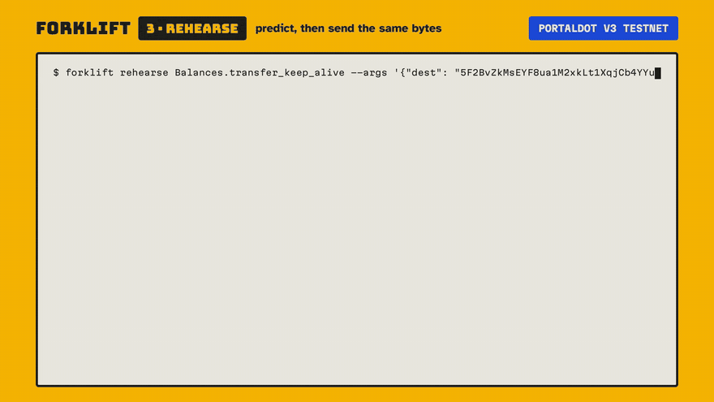
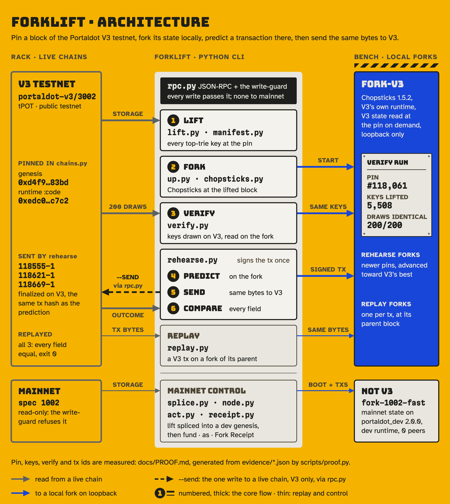
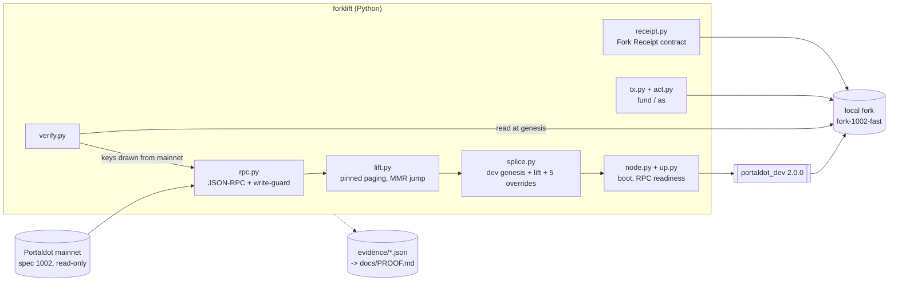

<a id="forklift"></a>

<div align="center">
  
  <h1>Forklift 🏗️</h1>
  <p><em>A local fork of the Portaldot V3 testnet (or of mainnet state), pinned at a block and checked against the live chain key by key: predict a transaction on the fork, then send the same bytes to V3 and compare.</em></p>
  

  <br/>

  [](https://forklift.edycu.dev)
  [](https://github.com/edycutjong/portaldot-hackathon-2026-forklift-edycu/blob/main/docs/pitch-deck.pdf)
  [](https://youtu.be/iVvEXQvfTYY)
  [](https://dorahacks.io/build/50248)
  [](https://dorahacks.io/hackathon/portaldot-hacker-house-2026/detail)

  <br/>

  
  
  
  [](https://github.com/edycutjong/portaldot-hackathon-2026-forklift-edycu/actions/workflows/ci.yml)
  [](https://github.com/edycutjong/portaldot-hackathon-2026-forklift-edycu/releases/latest)
  

</div>

---

<div align="center">
  
  <br/><sub>B-roll: rehearse on the fork, then send to V3 (2× speed) · <a href="https://youtu.be/iVvEXQvfTYY">full demo video</a></sub>
</div>

Portaldot Hacker House 2026 · Track: Node Operations & Tooling

<a id="project-name"></a>

## 🏷️ Project Name

**Forklift** (`portaldot-forklift`, version 0.1.0): a command-line tool that gives a Portaldot developer a local chain
that starts from **mainnet's real state** instead of an empty dev chain.

> **Status: check-in slice.** Everything described as shipped below is in this repository and was measured on
> 2026-10-14 (mainnet path) and 2026-10-20 (V3 path) (measured numbers come from [`docs/PROOF.md`](docs/PROOF.md), generated from [`evidence/`](evidence); test counts from `pytest -q`; the contract size from `wc -c forklift/contracts/receipt.wasm`). Everything
> else is marked **planned**. Forklift has two targets, always labelled: **`fork-v3`**, a fork of the live
> **Portaldot V3 testnet** run by Chopsticks with V3's own runtime, and **`fork-1002-fast`**, a local fork of
> Portaldot mainnet state (spec 1002) on the `portaldot_dev` dev runtime, which is not V3 (see *V3 status*).
> Mainnet also has a **`fork-1002-exact`** profile (2026-10-31 WIB): Chopsticks on mainnet's own runtime at the pin,
> also not V3.

<a id="project-overview"></a>

## 💡 Project Overview

### Problem Statement

A local `portaldot_dev --dev` chain is a development chain: one validator named Alice, none of mainnet's accounts,
stakes or nominators. A builder who wants to test one staking call, or one contract, against the state their users are
actually on has no simple way to get that state onto a local node, and no way to check that what they got is faithful.

### Solution

Forklift is five steps.

1. **Lift.** `forklift lift` reads every top-level storage key of Portaldot mainnet at one pinned block hash (the
   Merkle Mountain Range storage is skipped, not paged through) and records what it read in a manifest with a
   `manifest_root` hash over every key/value pair.
2. **Splice and boot.** `forklift up` writes the lift into the `portaldot_dev` 2.0.0 chain spec, keeps the dev
   consensus keys so the node can author, applies five named overrides, boots the node on loopback-only ports with zero
   peers, and waits (over RPC) until it authors and finalizes.
3. **Verify.** `forklift verify` draws keys **from mainnet** (inside storage maps, weighted by how many keys each map
   holds), reads each on mainnet at the pin and on the fork at genesis, and exits `0` only when every key is identical
   or explained (dev-kept, override, reset) and the whole-fork checks pass (key set, issuance, overrides, runtime code hashes). It is a sample, not a proof of every key.
4. **Rehearse on V3.** `forklift up --target v3` lifts the live V3 testnet at a pinned block and forks it there
   with Chopsticks (V3's own runtime wasm; there is no public V3 node binary), and `verify` checks that fork against
   the live chain and the lift. `forklift rehearse <Pallet.call>` signs one extrinsic once, applies those exact bytes on
   the fork (the prediction: events, fee, balance deltas), and with `--send` sends the same bytes to the V3 testnet and
   compares the two outcomes field by field. `forklift replay <block>-<index>` re-applies any V3 extrinsic's own bytes
   on a fork of its parent block and checks the fork reproduces what the chain recorded.
5. **Act (mainnet path).** `forklift fund` sets a balance, `forklift as <account> <Pallet.call> <args>` dispatches a call with a real
   mainnet account's origin (through `Sudo.sudo_as`), and `forklift receipt` deploys a small contract that emits the
   lift's block hash, `manifest_root` and key count as a `ContractEmitted` event on the fork, so a fork's origin is recorded on the fork itself.

**Shipped, in this repository today:**

- The lift engine: pinned paging, MMR cursor jump, per-page checkpoints, exit code `4` with the last cursor when the node
  fails for good (a partial lift is never written as complete), completeness checked against a second, unskipped full
  listing of the same block through the same RPC (`scripts/completeness.py`).
- The splice, node runner (tarball sha256-checked on download, binary sha256 recorded in the manifest, PID guard, no peers), `up` / `down`.
- `verify` with exit codes `0` / `2` and a reproducible seed.
- `fund`, `as`, `tx` (re-read any extrinsic by id), and the **Fork Receipt** contract with a rent check.
- **Fork Receipt v2 on the V3 testnet**: `receipt --target v3` deploys a Revive contract and attests a lift manifest
  (block hash, manifest root, key count stored on chain; every write dry-run through `ReviveApi` first);
  `tx --target v3` re-reads the attest by extrinsic id and reads the stored receipt back.
- The V3 target: chain profiles pinned by genesis and runtime `:code` hash (`forklift/chains.py`), V14 metadata names,
  `up --target v3` (Chopsticks fork that must serve V3's genesis, the pinned runtime and the lifted block), V3 `verify`
  (sampled keys drawn on the live chain, plus the whole key set and every lifted value against the fork), and
  `rehearse` (predict on the fork, then `--send` the same bytes to V3; exit `7` when the chain differs), and `replay`
  (any V3 extrinsic on a fork of its parent block, compared field by field).
- `up --runtime exact`: a Chopsticks fork of the mainnet pin on mainnet's own runtime `:code` (read at the pin), with
  the same four state keys as the fast fork (sudo key, era policy, the dev key's account, issuance; not `:code`)
  set on the next block; `verify` exits 0 on it at #2,725,953
  ([`evidence/verify-1002-exact-2725953.json`](evidence/verify-1002-exact-2725953.json)).
- `runtime-diff` (mainnet 1002 vs V3 3002: versions, pallets, calls, storage items, constants) and `runtime-compare`
  (one call on a fast and an exact fork of the same pin) → [`docs/RUNTIME-DIFF.md`](docs/RUNTIME-DIFF.md).
- An endpoint write-guard: nothing is ever submitted to mainnet, and a fork client refuses any non-loopback
  endpoint or a chain whose genesis is mainnet's (or V3's, unless it answers Chopsticks' `dev_*` methods). The two
  paths to a real chain are `rehearse --send` and `receipt --target v3`: a testnet client that sends only
  `author_submitExtrinsic`, only to V3.
- `--json` output and documented exit codes ([`docs/EXIT-CODES.md`](docs/EXIT-CODES.md)); 324 offline tests plus 10 live
  tests.

**Planned (not built, not claimed):** a hosted fork, a PyPI package and a CI action.

### Blockchain Relevance

Forklift is node-operations and developer tooling for Portaldot. On V3 it reads the live testnet
(`wss://test-node-v3.portaldot.dev`, `portaldot-v3`/3002), forks it locally, and sends real transactions to it only after
predicting them on the fork. On the mainnet path it reads real chain state through the public node
(`wss://mainnet.portaldot.io`), runs it on the `portaldot_dev` 2.0.0 node, uses Portaldot's historical-state
RPC (`state_getKeysPaged`, `state_queryStorageAt` at a block hash), the Sudo pallet to act as accounts on the fork, and
the Contracts pallet for the receipt. Every fork is labelled with the spec of the state it carries and its runtime mode (`fast` = the dev runtime wasm), so
nobody mistakes it for a testnet or for V3.

### Boundaries (read before trusting a fork)

- **Block heights restart.** The fork starts at block 0; mainnet's block numbers (for example 2,725,953) mean nothing on
  it. Calls whose meaning depends on block numbers (Vesting schedules, Proxy announcements, Scheduler) will not behave as
  on mainnet; `forklift as` prints a warning for them.
- **`sudo_as` is not a signed dispatch.** The call runs with the target account's origin, but the target pays no fee,
  its nonce is not touched and its signed extensions do not run. The fork's dev sudo key signs the outer extrinsic.
- **A local fork is not V3, and not mainnet's runtime.** `fork-1002-fast` runs the dev runtime wasm (the manifest records
  both code hashes), with dev consensus keys, 6-second blocks and staking era changes disabled (`Staking.ForceEra`
  override). It is a dev tool, not an audit tool.
- **A V3 fork is Chopsticks, not a V3 node.** It runs V3's runtime wasm, but with `allow-unresolved-imports`: without
  it, Chopsticks 1.5.2 fails every state call on V3 (`Unresolved function env:ext_statement_store_submit_statement_version_1`,
  an import of V3's Statement pallet). It reads untouched state lazily from the live endpoint, and it reads the 11
  top-trie child-trie roots (Revive contract storage) as null; `verify` counts and lists them.
- **Fees move every block on V3.** `TransactionPayment.NextFeeMultiplier` changed between every pair of 20 consecutive
  blocks (`evidence/v3-fee-multiplier-118206-118225.json`), so `rehearse` first builds empty fork blocks up to the
  chain's best block, sets the chain's multiplier at that height on the fork if the two differ (both recorded), and
  predicts inclusion in the next block. If the chain includes it later, the fee may differ and `rehearse` says so
  (exit `7`); it never adjusts a prediction after the fact.
- **Top trie only.** Child tries are not lifted (the manifest reports a `child_trie_roots_not_lifted` count; it is not recorded in `evidence/`).
- **Mainnet-path evidence is local.** The V3 transactions in *Demo* are on the public V3 testnet (node-console links in
  [`docs/PROOF.md`](docs/PROOF.md)). The contract address and the mainnet-path transaction hashes live on a local fork, not on a public
  explorer; `forklift tx <block-index>` re-reads any of them from the author's running fork (a fresh fork gives new
  hashes; the recorded rows are in `evidence/txs-2725953.json` and `evidence/refetch-2725953.json`).

<a id="technical-architecture"></a>

## 🏗️ Technical Architecture



Forklift only reads the live chains on the left, except `rehearse --send` and `receipt --target v3`, which submit to V3; every other write goes to a local fork on the right.

<details>
<summary>Diagram as text (Mermaid)</summary>



</details>

The full module-level diagram, the splice rules and the invariants the code enforces are in
[`ARCHITECTURE.md`](ARCHITECTURE.md).

**Core tech stack**

| Layer | Choice |
|---|---|
| Blockchain platform | **Portaldot V3 testnet** (`portaldot-v3`/3002, tPOT): lifted read-only, forked with Chopsticks (`fork-v3`), and written to only by `rehearse --send` and `receipt --target v3`. Control path: a local fork of **Portaldot mainnet state (spec 1002)** on the `portaldot_dev` 2.0.0 node with its dev runtime, labelled `fork-1002-fast`, which is not V3. |
| Contract language | Receipt v2 (V3 testnet): Yul, Solidity's assembly language, compiled with `solc` 0.8.30 to EVM bytecode, which V3's Revive pallet runs; ABI in `IForkReceipt.sol`. Receipt v1 (fork): WAT (WebAssembly text), hand-written for the rent-era Contracts pallet of the dev runtime the fork runs (`seal0` host functions only, plus the `env` memory import), compiled with `wat2wasm` |
| Frontend | None. Forklift is a command-line tool. |
| Other components | Chopsticks 1.5.2 via `npx` (V3 fork executor; Node.js 18+), Python 3.11+, `click` (CLI), `websockets` (raw JSON-RPC), `xxhash` (storage key hashing), `substrate-interface` (sr25519 keys and the SCALE type registry), `hashlib` blake2b. Tests use `pytest`. |

**V3 status.** On 2026-10-14 the V3 testnet RPC listed in the V3 guide (`testnetv3-node.feso-apps.xyz`) did not
resolve, so the check-in slice was built on the mainnet path. The V3 testnet launched on new endpoints
(`wss://test-node-v3.portaldot.dev`, explorer [node-console.portaldot.dev](https://node-console.portaldot.dev/)); on
2026-10-20 Forklift pinned it (genesis `0xd4f9…83bd`, `:code` `0xedc0…c7c2`, spec `portaldot-v3`/3002, tPOT, 14 decimals)
and its V3 rows in [`docs/PROOF.md`](docs/PROOF.md) were measured there. No public V3 node binary or chain
spec exists (organisers' Discord, not archived here), so a V3 fork runs on Chopsticks, not on a node binary.

<a id="smart-contracts"></a>

## 📜 Smart Contracts

One contract, the **Fork Receipt**, in two versions: **v2** is public, on the Portaldot V3 testnet's Revive pallet;
**v1** lives on a local fork's own Contracts pallet and goes away with the fork.

**v2: Revive contract on the V3 testnet** (`forklift/contracts/ForkReceipt.yul`, interface `IForkReceipt.sol`,
compiled `ForkReceipt.bin`, 84 bytes of init code, 74 bytes of runtime code). Deployed and attested by
`forklift receipt --target v3` from the funder `5EnCf9…Cejvg`; full hashes, deposits and fees in [`docs/PROOF.md`](docs/PROOF.md):

| What | Value |
|---|---|
| Contract address (H160) | `0x52f0edd92af9ff410ca63ccc83735552e1b2abc7` |
| Deploy | `Revive.instantiate_with_code`, extrinsic `257997-1`, tx `0x54365766d8182b7ca54a1ac8a5abaecd9ac490bf4933ae039775f561f2c8480d`, finalized |
| Attest | `Revive.call`, extrinsic `258000-1`, tx `0x8e1588a185686bd52ac764c3beffa5aa39ea985efb55745dc76e609be9d96710`, finalized |
| What it attests | the V3 lift at #118,061: block hash `0xec57…d8ac`, manifest root `0xfe49…30a4`, 5,508 keys; the emitted event and the stored `receipt()` both equal the manifest |
| Re-read | `forklift tx 258000-1 --target v3` (also a live test) |

| Function | Input | What it does |
|---|---|---|
| `attest(bytes32 blockHash, bytes32 manifestRoot, uint64 keysLifted)` | ABI-encoded | Stores `manifestRoot` and `keysLifted` under `blockHash` (a later attest overwrites) and emits the anonymous event `Attested(blockHash, manifestRoot, keysLifted, attester)` as `Revive.ContractEmitted` |
| `receipt(bytes32 blockHash)` (view) | ABI-encoded | Returns `(manifestRoot, keysLifted)`; `(0, 0)` when nothing was attested for that block hash or for its bitwise complement |

Why Yul and not a compiled Solidity contract: Revive holds a storage deposit per code byte and per storage slot. Measured
on V3 with `ReviveApi_instantiate` dry runs (`scripts/revive_deposits.py` → `evidence/revive-deposits-v3.json`): 13.11 tPOT
plus 0.078 tPOT per byte of runtime code, and 3.8415 tPOT per 32-byte slot written. A plain-Solidity Receipt with the same purpose
(`scripts/ForkReceiptSolidity.sol`, not deployed; richer than v2: an append-only list with an id and the attest block number) compiled with `resolc` 1.5.0 to PolkaVM (7,851 bytes) needs a 625.488 tPOT
deposit, and compiled with `solc` 0.8.30 to EVM bytecode (991 bytes) 88.224 tPOT; the funder held 29.527 tPOT.
The Yul build deployed for an 18.882 tPOT deposit and the attest held 7.683 tPOT, both equal to their dry runs. To fit,
the event is anonymous (no 33-byte signature topic), value transfers are not refused, and `keysLifted` is not
range-checked on chain (Forklift encodes a u64 and refuses anything larger before signing).

**Trust model.** Anyone may attest, and a later attest overwrites the stored receipt for a block hash. The two slots of
an attested hash `h` are `h` (root) and `not(h)` (key count), so an attest for the complement `not(h)` also overwrites
`h`'s key count, and `receipt(not(h))` returns `h`'s two values swapped. The stored receipt is therefore a convenience
read; the record to trust is the `Attested` event from a known attester (the funder's H160 above), which is kept for
every attest and which `forklift tx <id> --target v3` decodes.

**v1: the fork's Contracts pallet** (`forklift/contracts/receipt.wat`, compiled `receipt.wasm`, 169 bytes). It is
hand-written for the rent-era Contracts pallet of the dev runtime the fork runs (`fork-1002-fast`); it has not been run on mainnet's runtime wasm. It needs no Rust toolchain.

| Function | Input | What it does |
|---|---|---|
| `deploy`, `call` (both run `attest`) | 72 bytes: mainnet block hash ‖ `manifest_root` ‖ `keys_lifted` (u64, little-endian) | Emits `Contracts.ContractEmitted(<contract>, <the 72 input bytes>)`. Any other input length traps, so a malformed attest fails instead of emitting. |

Deployed on the local fork `fork-1002-fast` at mainnet #2,725,953 (fork genesis `0x9163…80ac`), by
`forklift receipt` (full hashes and the rent measurements are in [`docs/PROOF.md`](docs/PROOF.md)):

| What | Value |
|---|---|
| Contract address | `5EMSUfyyk1aY62M8XGdgAYAwyqd3R7sGbXFERaW5ZVBHeTXv` |
| Instantiate | extrinsic `21-1`, tx `0xd114c4659cbbbbb7a0cf6cc7f4062aecdbdb9d070593cf7365842e10015e0003` |
| Rent top-up | extrinsic `24-1`, tx `0x0fc273a8d888e63d6f50134494e286abbdaba36ddc092b869e7df6eb26fc7c02` |
| Attest | extrinsic `27-1`, tx `0x610dd887f9a1a8666f06c8a206fe00da80755b0cad33f57cf3282ee1c286789a`; the emitted payload equals the fork manifest |

Pallet calls Forklift composes (all on a fork): `Sudo.sudo(Balances.set_balance)`, `Sudo.sudo_as(Balances.transfer)`,
`Sudo.sudo_as(Staking.nominate)`, `Contracts.instantiate_with_code`, `Balances.transfer`, `Contracts.call`. The lift
itself is pallet-free: it only calls read RPC methods (`chain_getFinalizedHead`, `chain_getBlockHash`,
`chain_getHeader`, `state_getRuntimeVersion`, `state_getKeysPaged`, `state_queryStorageAt`, `state_getStorage`,
`state_getMetadata`).

**Rebuild the contracts:** v2: `solc --strict-assembly --optimize --evm-version cancun --bin forklift/contracts/ForkReceipt.yul`
(solc 0.8.30; the last line of its output is the hex in `ForkReceipt.bin`, which adds a `0x` prefix). v1: `wat2wasm forklift/contracts/receipt.wat -o forklift/contracts/receipt.wasm`.
`pytest` checks that both committed builds are exactly what those commands produce, when `solc` 0.8.30 and `wat2wasm` are installed.

<a id="installation--setup"></a>

## 🚀 Installation & Setup

**Requirements:** Python 3.11+; network access to `wss://mainnet.portaldot.io` (live lifts and `verify`; the unit tests
are offline); measured on macOS arm64 only (the Linux download path exists but was not run); on Apple silicon, Rosetta (`softwareupdate --install-rosetta`), because the macOS `portaldot_dev` binary is
x86_64 only. `forklift up` downloads the `portaldot_dev` 2.0.0 tarball (`portaldot-testnet-*.tar.gz` in the community repository
`portaldotVolunteer/Portaldot-node`, not a GitHub Release) into `~/.cache/forklift/bin/` and checks its sha256 before
unpacking it.

```bash
git clone https://github.com/edycutjong/portaldot-hackathon-2026-forklift-edycu.git
cd portaldot-hackathon-2026-forklift-edycu
python3 -m venv .venv
. .venv/bin/activate
pip install -e '.[dev]'
pytest -q                                   # offline unit tests

forklift lift --at 2725953                  # read-only: one lift at a pinned block (~20 s)
forklift up --at 2725953                    # lift -> splice -> boot the fork on ws://127.0.0.1:9944
forklift verify --sample 200                # exit 0 = nothing unexplained
forklift fund 5F1KbjNTUu6xmMCcSz2wrv7b627BKS7hUTzWFqdmpvb3rMcE 1000000
forklift as 5DvRSgerqB5KHPqWGGnCtRJgJokj91XyGLm3aZ5DKH1rMndf Balances.transfer \
  '["5F1KbjNTUu6xmMCcSz2wrv7b627BKS7hUTzWFqdmpvb3rMcE", 100000000000000000]'
# act as a real nominator: targets = the first three keys of Staking.Validators at the pin
forklift as 5Cf8KJFLVrY43yEZN3vgFktGZvhUhrt7WBvfjJoTr54EjchW Staking.nominate \
  '[["5DSHUMkUHoT78nPaACjs85TjxoHosinc47Yfpes38wWknDCD","5FCM6payzb4zo3oWPKUZDpgcBAMSyYS4vY5b3YuRtCCGRnmn","5EhWJRiq4XLw2mErQXZoHeASfC8MjujgBYhomDD9YeWMYgF6"]]'
forklift receipt                            # deploy the Fork Receipt, keep it rent-free, attest
forklift down                               # stop the fork (only the PID it recorded)
```

**V3 testnet** (also needs Node.js 18+: `npx` fetches Chopsticks 1.5.2 on first use). A signer file holds a mnemonic,
`0x` seed or `//URI`, must be mode 600, and is never printed:

```bash
forklift up --target v3 --at head --name v3         # lift V3 at its finalized head, Chopsticks fork on ws://127.0.0.1:9944
forklift verify --name v3 --sample 200              # exit 0 = fork = live chain at the pin = the lift
forklift rehearse System.remark --args '{"remark": "0x666f726b6c696674"}' \
  --signer ~/.config/forklift/my-v3.seed --name v3   # predict on the fork only
forklift rehearse System.remark --args '{"remark": "0x666f726b6c696674"}' \
  --signer ~/.config/forklift/my-v3.seed --name v3 --send --evidence evidence   # predict, send to V3, compare
forklift replay 118621-1                            # re-run a V3 extrinsic on a fork of its parent block, compare
forklift receipt --target v3 --name v3 --signer ~/.config/forklift/my-v3.seed --evidence evidence
                                                    # Fork Receipt v2: deploy once, attest this fork's manifest on V3
forklift tx 258000-1 --target v3                    # re-read a Receipt attest on V3 by extrinsic id
forklift down --name v3
```

`rehearse` refuses a fork whose copy of the signer's (or any named account's) `System.Account` differs from the chain's
finalized head: re-run `up --target v3 --at head`. An unfunded signer is predicted to fail (the fork's pool rejects it,
exit `5`) and nothing is sent.

Pinning block 2,725,953 reproduces `manifest_root`
`0xa430d6a9f16d631da45fd0d0cb5ae600db1854612218e21aabeb7f26d7ba002b` while the public node keeps serving that block.
`--at head` pins the latest finalized block instead. Every command except `down` takes `--json`; `lift`, `up`, `verify`, `fund`, `as` and `receipt` take `--evidence DIR`,
which records a run for [`docs/PROOF.md`](docs/PROOF.md) (`python scripts/proof.py`). `forklift up` listens on 9944 (WebSocket), 9933 (HTTP) and
30333 (p2p, loopback only) by default; override with `--ws-port`, `--rpc-port`, `--p2p-port` or `FORKLIFT_WS_PORT` /
`FORKLIFT_RPC_PORT` / `FORKLIFT_P2P_PORT`. Other commands find the fork with `--name` (default `fork`) or `--endpoint`. `forklift as` also takes any other `Pallet.call` composed from the runtime metadata with a JSON argument list (only the two calls above are recorded in `evidence/`). If no `portaldot_dev` is found via `--node-bin` / `FORKLIFT_NODE_BIN`, `~/.cache/forklift/bin` or PATH, `up` downloads and sha256-checks the tarball; a binary found that way is only hashed and recorded.

**Exit codes:** `0` success · `1` could not run · `2` mismatch (`verify`, `receipt`) · `3` node failed · `4` lift failed
(last cursor printed, checkpoint kept) · `5` the carried call failed (`rehearse`: predicted to fail, not sent) · `6` Receipt not rent-safe ·
`7` the V3 testnet differed from the fork's prediction (`rehearse`) or the replay differed from the chain (`replay`) ·
`64` usage error.
Per command, in [`docs/EXIT-CODES.md`](docs/EXIT-CODES.md).

**Compile & deploy / launch frontend:** the contracts are compiled with `solc` (v2) and `wat2wasm` (v1) (commands above;
both builds are committed) and deployed by `forklift receipt --target v3` (v2, on V3) and `forklift receipt` (v1, on a fork);
there is no frontend.

<a id="demo"></a>

## 🎬 Demo

- **Video:** demo: https://youtu.be/iVvEXQvfTYY
- **Pitch deck:** [`docs/pitch-deck.pdf`](docs/pitch-deck.pdf) (10 slides, check-in; source [`deck/index.html`](deck/index.html)). Its figures are the rows of [`docs/PROOF.md`](docs/PROOF.md).
- **Live demo:** none; Forklift is a CLI and its fork is local. The Installation steps reproduce the lift, fork, verify, fund / as and Receipt rows (extrinsic ids, hashes and timings differ per run); completeness, re-read and bench are `scripts/completeness.py`, `scripts/refetch.py` and `scripts/bench.py`.
- **Test accounts / test data:** none to create. The whale `5DvRSg…Mndf` (200,000,000 POT at the pin; 1 POT = 10^14 planck, a convention because spec 1002's `system_properties` is empty) and the nominator
  `5Cf8KJ…jchW` are real mainnet accounts that `forklift as` acts as on the fork; `5F1Kbj…rMcE` is the demo account
  `forklift fund` credits.
- **Evidence:** [`docs/PROOF.md`](docs/PROOF.md), generated from [`evidence/`](evidence). Measured on 2026-10-14
  (Darwin arm64, Python 3.11.1; the x86_64 `portaldot_dev` node under Rosetta):

| Measurement | Result | Evidence |
|---|---|---|
| Keys lifted at #2,725,953 (`0xf9dc…5432`) | 16,324 keys, 5,589,646 B of values, 19 pages | `evidence/lift-2725953.json` |
| Lift time (keys / values / total) | 6.88 s / 10.18 s / 17.06 s | `evidence/lift-2725953.json` |
| Completeness against a second, unskipped full listing at the same hash, minus the MMR range | 16,324 lifted = 16,324 listed outside the MMR range · 0 missing, 0 extra · MMR range 5,451,900 listed = 5,451,900 derived (full listing: 5,468,224 keys, 5,470 pages, 645.6 s) | `evidence/lift-completeness-2725953.json` |
| Completeness at the earlier pin #2,725,639 | 16,332 lifted = 16,332 listed · 0 missing, 0 extra | `evidence/lift-completeness-2725639.json` |
| Fork boot (`fork-1002-fast`, genesis `0x9163…80ac`) | RPC up 11.7 s (best block already #1) · first new block at 17.8 s · finalized #1 at 24.9 s · 0 peers | `evidence/fork-2725953.json` |
| Lifted keys on the fork | 16,324 = 9,524 genesis-identical + 6,796 dev-kept + 4 overridden (genesis 9,563 keys; the fifth override, the dev key's account, is not a mainnet key) | `evidence/fork-2725953.json` |
| `forklift verify --sample 200` | exit 0 · 200 keys from mainnet: 120 identical, 80 dev-kept · key set, issuance, overrides, code hashes ok · seed `15629954055902865514` | `evidence/verify-2725953.json` |
| `fund`, `as` (whale transfer), `as` (nominator `Staking.nominate`) | extrinsics `12-1`, `15-1`, `18-1`, all `Ok`; whale 200,000,000 → 199,999,000 POT with nonce unchanged; nominator targets 1 → 3 | `evidence/txs-2725953.json` |
| Fork Receipt | instantiate `21-1`, rent top-up `24-1`, attest `27-1`; `ContractEmitted` payload = block hash ‖ manifest root ‖ 16,324 keys, equal to the manifest | `evidence/txs-2725953.json` |
| All six transactions re-read by extrinsic id from a separate process | 6 of 6 identical | `evidence/refetch-2725953.json` |
| V3 testnet: lift, fork, verify at #118,061 | 5,508 keys, two fresh lifts with the same root · Chopsticks fork serves the pinned block, genesis and runtime · `verify --sample 200` exit 0: 200/200 identical, key set 5,508 = 5,508, 5,497 values identical + 11 child-trie roots read null | `evidence/lift-v3-118061.json`, `evidence/fork-v3-118061.json`, `evidence/verify-v3-118061.json` |
| V3 testnet: three transactions from `5EnCf9…Cejvg`, each predicted on a fork first, then sent | `System.remark` 118555-1, `Balances.transfer_keep_alive` (0.2 tPOT) 118621-1, `Utility.batch` (remark + 0.1 tPOT) 118669-1, all finalized · same tx hash, success and event sequence as predicted, recipient deltas exact · fees differ by 3,660–8,269 planck because each landed 3–9 blocks after the predicted height | `evidence/rehearse-v3.json`, [`docs/PROOF.md`](docs/PROOF.md) (block hashes + node-console links) |
| V3 testnet: the same three replayed on forks of their parent blocks | 10/10, 14/14 and 16/16 fields equal to the chain, fees equal to the planck | `evidence/replay-v3.json` |
| An unfunded signer | the fork's pool rejects it (`Invalid: Payment`), exit `5`, nothing sent | `evidence/rehearse-v3.json` |
| V3 testnet: Fork Receipt v2 (Revive contract) | `0x52f0edd92af9ff410ca63ccc83735552e1b2abc7`: deploy 257997-1, attest 258000-1, both finalized · emitted event and stored `receipt()` = the #118,061 manifest (root, 5,508 keys) · deposits 18.882 + 7.683 tPOT = the dry runs | `evidence/receipt-v3.json` |
| Tests | 324 offline passed (+1 that runs only when `solc` 0.8.30 is installed) · 10 live tests (deselected offline; run with `pytest -m live`) | `pytest -q` |

One benchmark run of the lift from a fresh process (a stub: one run per file; p50/p95 over several runs is planned): #2,725,953 in 19.85 s (keys 7.41 s, values 12.44 s), same `manifest_root` (`evidence/bench-lift-2026-10-14.json`).

<a id="development"></a>

## 🧪 Development

```bash
pip install -e '.[dev]' ruff
ruff check .
pytest -q        # offline; CI runs the same, see [CONTRIBUTING.md](CONTRIBUTING.md)
```

<a id="roadmap"></a>

## 🗺️ Roadmap

**Completed (check-in slice, 2026-10-14)**

- [x] JSON-RPC client with retry/backoff and the endpoint write-guard
- [x] Pinned lift with MMR cursor jump, checkpointing and exit code `4`; completeness check against a second, unskipped listing
- [x] `fork.manifest.json` with per-pallet/item counts, `manifest_root`, and the full lifted-key accounting
- [x] Splice, `portaldot_dev` node runner and `forklift up` / `down` (authors and finalizes, 0 peers)
- [x] `forklift verify` (keys drawn from mainnet, whole-fork checks, exit codes)
- [x] `forklift fund`, `as`, `tx`, and the Fork Receipt contract with its rent check
- [x] V3 target (2026-10-20): pinned chain profile, `up --target v3` on Chopsticks, V3 `verify`, `rehearse` with `--send`
- [x] Generated evidence ([`docs/PROOF.md`](docs/PROOF.md)), [`ARCHITECTURE.md`](ARCHITECTURE.md),
      [`docs/DX-REPORT.md`](docs/DX-REPORT.md), [`docs/EXIT-CODES.md`](docs/EXIT-CODES.md)

**Next phase**

- [x] Demo video (linked at the top of this README)
- [x] `--runtime exact`: mainnet's own wasm on a Chopsticks fork of the pin (`verify` exit 0), and a generated runtime-difference report ([`docs/RUNTIME-DIFF.md`](docs/RUNTIME-DIFF.md))
- [x] `forklift replay <block>:<index>`: a mainnet extrinsic re-run on a fork of its parent block (3 mainnet replays field-equal, [`evidence/replay-1002.json`](evidence/replay-1002.json))
- [ ] Benchmarks with p50/p95 over several runs
- [ ] A hosted fork, a PyPI package and a CI action
- [x] The Fork Receipt as a Revive contract on the V3 testnet (`0x52f0…abc7`, deploy 257997-1, attest 258000-1)
- [x] A mainnet (1002) → V3 report: which lifted keys carry over, which need re-encoding, which have no home on V3 ([`docs/MIGRATION-1002-V3.md`](docs/MIGRATION-1002-V3.md))

<a id="team"></a>

## 👥 Team

- **Team name:** edycu
- **Members and roles:** Edy Cu, solo (design, review, on-chain decisions)
- **Contact:** via the DoraHacks BUIDL page (hackathon only)

**AI assistance disclosure.** Claude Code (Anthropic) drafted most of the code, tests and this README under the
author's direction. The architecture, protocol choices and the on-chain design were decided by the author, who reviews
the code and can explain how the lift, the splice, `verify` and the Receipt work. All code in this repository was
committed from 2026-10-14 (first commit `fa113a6`); earlier research is not included.

Open-source libraries: `click`, `websockets`, `xxhash`, `substrate-interface`, `pytest`, `hatchling`. The node binary
is `portaldot_dev` 2.0.0 from the `portaldot-testnet-*.tar.gz` tarballs in `portaldotVolunteer/Portaldot-node`, downloaded at run time.

<a id="license"></a>

## 📄 License

MIT, see [`LICENSE`](LICENSE).
