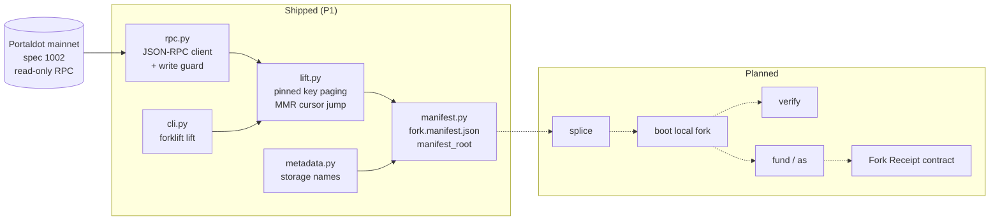

<div align="center">

# Forklift

**Portaldot mainnet state, lifted at a pinned block, checked key by key.**


Portaldot Hacker House 2026 · Track: Node Operations & Tooling

</div>

## Project Name

**Forklift** (`portaldot-forklift`, version 0.1.0).

> **Status: work in progress.** This is README v0. It describes only what the repository does today: a read-only
> **lift** of Portaldot **mainnet (runtime spec 1002)** state at a pinned block, with a manifest and measured
> evidence. Everything else is marked **planned**.

## Project Overview

### Problem Statement

Portaldot's official testnet client boots an empty chain: one validator (Alice) and none of mainnet's accounts,
stakes or nominators. A builder who wants to test one staking call, or one contract, against the state their users
are actually on has no faucet to lean on and no way to get that state locally.

### Solution

Forklift reads the whole storage of a Portaldot chain at one pinned block hash and records what it read in a
`fork.manifest.json` (source block and hash, key counts per pallet and item, a `manifest_root` hash over every
key/value pair).

**Shipped (this repo, today):**

- `forklift lift --at N|0xhash|head` pages every storage key **at the pinned block hash**, fetches values at the
  same hash, and writes the lift to `~/.cache/forklift/lifts/<block>/`.
- The Merkle Mountain Range (MMR) storage is skipped without being listed: the lift pages keys until the page that
  reaches the MMR prefix, then jumps the cursor past it. The MMR holds 5,451,269 keys at the pinned block; none are
  fetched. (One probe page reaches the range, so up to 999 MMR keys can be listed by that page and are dropped.)
- Progress is checkpointed after every page. If the node fails for good, the lift exits with code `4` and prints the
  last cursor; a partial lift is never written as complete.
- A write guard refuses to send `author_*` calls to anything that is not a local fork.
- Every key is named by pallet and item, including storage the spec-1002 metadata does not describe.

**Planned (not built yet, not claimed):** splice the lift into the official node's chain spec and boot a local fork
(`fork-1002-fast`), `verify` the fork against mainnet, `fund` / `as` (act as a real account), a Fork Receipt contract,
an `exact` runtime profile, and a hosted fork.

### Blockchain Relevance

Forklift is node-operations and developer tooling for Portaldot. It reads real chain state through the public
archive node (`wss://mainnet.portaldot.io`) and is designed so tests run against the state of the live chain rather
than an empty dev chain. It never signs or submits anything to mainnet.

## Technical Architecture



**Core tech stack**

| Layer | Choice |
|---|---|
| Blockchain platform | **Portaldot V3** is the hackathon target. Current runs are a read-only lift of **Portaldot mainnet (runtime spec 1002)**, not V3. A local mainnet fork profile (`fork-1002-*`) is planned. |
| Contract language | Planned: a small Fork Receipt contract (see Smart Contracts). None exists yet. |
| Frontend | None. Forklift is a command-line tool. |
| Other components | Python 3.11+, `click` (CLI), `websockets` (raw JSON-RPC), `xxhash` (storage key hashing), `hashlib` blake2b. Tests use `pytest`. |

**V3 status.** As of 2026-10-14 the V3 testnet RPC listed in the organisers' guide
(`wss://testnetv3-node.feso-apps.xyz`) did not resolve in DNS, and the organisers have said that no V3 node binary
or chain spec is public and that an older devnet configuration should not be assumed compatible with the V3 testnet.
Forklift therefore makes **no V3 claim**; nothing in this repository has run against V3.

Measured source of every number below: [`docs/PROOF.md`](docs/PROOF.md), generated from [`evidence/`](evidence).

## Smart Contracts

Forklift has **no deployed contract yet**, so there is no contract address or transaction hash to list.

- **Planned: Fork Receipt contract** (phase P4): `attest(mainnet_block_hash, manifest_root)` would emit the pinned
  mainnet block hash, the manifest root and the number of lifted keys as an event, so a fork's origin is on-chain.
- Directory: none yet. Deployment instructions will be added with the contract.

The lift itself is pallet-free: it only calls the node's read RPC methods (`chain_getBlockHash`, `state_getKeysPaged`,
`state_queryStorageAt`, `state_getMetadata`).

## Installation & Setup

**Requirements:** Python 3.11+, network access to `wss://mainnet.portaldot.io` (live lifts only; the unit tests are
offline).

```bash
git clone https://github.com/edycutjong/portaldot-hackathon-2026-forklift-edycu.git
cd portaldot-hackathon-2026-forklift-edycu
python3 -m venv .venv
. .venv/bin/activate
pip install -e '.[dev]'
pytest -q                       # offline unit tests
forklift lift --at 2725639      # one lift at a pinned block (~20 s on the measurement host)
forklift lift --at 2725639 --json   # print the manifest
```

Pinning block 2,725,639 reproduces `manifest_root`
`0x29f18c9250683ce3da0b6ee821674de99036bbc67afc32f42647d687b4c584e7` while the archive node keeps serving that block.
`--at head` pins the latest finalized block instead. Options: `--from` (archive node), `--out`, `--no-resume`,
`--evidence DIR`, `--json`.

**Exit codes:** `0` lift complete · `4` lift could not finish (last cursor printed, checkpoint kept) · `64` usage
error. Code `2` is reserved for `verify` mismatches (planned).

**Compile & deploy / launch frontend:** not applicable yet (no contract, no frontend).

## Demo

- **Video:** coming at check-in.
- **Live demo:** none; Forklift is a CLI.
- **Test accounts / test data:** none needed. The lift reads public mainnet state at block 2,725,639
  (`0xc6fb8d8a10ae3045b7cb6b0f24ddacc538006a1fae975ec343c8654fb55a8212`).
- **Evidence:** [`docs/PROOF.md`](docs/PROOF.md). Measured on 2026-10-14 (Darwin arm64, Python 3.11.1):

| Measurement | Result | Evidence |
|---|---|---|
| Keys lifted at #2,725,639 | 16,332 | `evidence/lift-2725639.json` |
| Independent full key listing at the same hash, minus the MMR range | 16,332 · set difference 0 missing, 0 extra | `evidence/lift-completeness-2725639.json` |
| MMR keys skipped (listed vs derived from `NumberOfLeaves`) | 5,451,269 / 5,451,269 | same file |
| Lift time (keys / values / total) | 7.37 s / 12.08 s / 19.45 s | `evidence/lift-2725639.json` |
| `manifest_root` identical across fresh-process runs | 3 runs, same root | `docs/PROOF.md` |
| Second pin, #2,725,653 | 16,316 keys, clean | `evidence/lift-2725653.json` |
| Tests | 85 offline passed, plus 1 live test (skipped offline) | `pytest -q` |

## Roadmap

**Completed (P1, 2026-10-14)**

- [x] JSON-RPC client with retry/backoff and the endpoint write guard
- [x] Pinned lift with MMR cursor jump, checkpointing and exit code `4`
- [x] `fork.manifest.json` with per-pallet/item counts and `manifest_root`
- [x] Completeness check of the lift against an independent listing
- [x] Generated evidence table ([`docs/PROOF.md`](docs/PROOF.md))

**Next phase (slice A, check-in on Oct 24)**

- [ ] D2: splice the lift into the official node's chain spec, boot the fork, `forklift verify`
- [ ] D3: `fund`, `as`, and the Fork Receipt contract with on-chain proof
- [ ] D4: README v1, architecture document, demo video

Afterwards: replay, an `exact` runtime profile, benchmarks and packaging (build-plan D5–D12).

## Team

- **Team name:** edycu
- **Members and roles:** Edy Cu, solo (design, review, on-chain decisions)
- **Contact:** via the DoraHacks BUIDL page (hackathon only)

**AI assistance disclosure.** Claude Code (Anthropic) drafted most of the code, tests and this README under the
author's direction. The architecture, protocol choices and the on-chain design were decided by the author, who reviews
the code and can explain how the lift works. All code in this repository was written during the hackathon window
(from 2026-10-14); earlier research is not included.

Open-source libraries: `click`, `websockets`, `xxhash`, `pytest`, `hatchling`.

## License

MIT, see [`LICENSE`](LICENSE).
